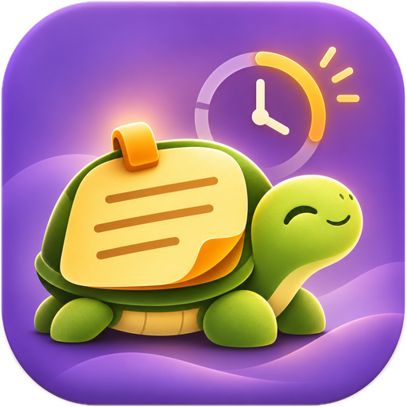

# 🐢 VesperShell

**Quiet notes. Gentle reminders. Your desktop, your data.**

VesperShell is a local-first Windows sticky-notes application built with Python and PySide6. It has no mandatory accounts, cloud sync, advertising, or telemetry. The current release line is **v0.3.5 beta**.



## Features

- Multiple independent notes: drag, resize, edit, pin, hide, restore, and delete with confirmation.
- Three signature themes (Moon Violet, Amber Ember, Turtle Grove) plus compatible classic colors.
- **TurtleTick:** silent countdown that moves from green to red and survives restart or sleep.
- **TurtleHide:** scheduled hide and reappear, once or daily (including across midnight).
- **TurtleFlip:** explicit **↓ Send back** button to lower a note without hiding it.
- Tray controls to create notes, restore hidden ones, adjust defaults, and quit safely.
- Optional **Start VesperShell with Windows**, disabled by default, using a per-user Startup shortcut.
- Local atomic JSON saving, conflict-safe recovery/migration, and Unicode including Hindi.
- **Offline Help** in the note's `⋯` menu and system-tray menu; the updated Windows build has been installed and Help was reported opening correctly in the default browser.

## Download and install

When a Windows installer is attached to a [GitHub Release](../../releases), download its **Setup EXE**, run it, and use the Start Menu entry. The installer uses your current user's Programs directory by default. An extracted portable build also works when its executable and complete `_internal` folder stay together.

The **source archive itself is not a Windows installer**. For building from source, see below.

### Run from source (Windows 10/11)

```powershell
py -3 -m venv .venv
.venv\Scripts\python.exe -m pip install -r requirements.txt
.venv\Scripts\python.exe main.py
```

Or use `install_windows.bat` and then `run_windows.bat`.

### Build from source

Use `build_windows.bat` after installing into `.venv`; it runs the existing project tests and builds using `VesperShell.spec`. Keep the entire `dist/VesperShell` folder together. The build script copies the offline Help, licence, and third-party notice files next to the packaged app.

PY2EXE Builder can also create a portable build, followed by an Inno Setup installer. To avoid dependency rediscovery, its **installer-from-existing-build** mode can wrap a verified portable application folder. Always check that the final installer has the correct app ID and includes the Help HTML.

## Using VesperShell

| Control | Action |
|---|---|
| `+` | Create note |
| `⌃` | Pin / unpin |
| `◉` | Change this note's theme |
| `◷` | Set quiet countdown |
| `⋯` | Schedule visibility, save, Help, hide, delete, or quit |
| `×` | Hide, **not** delete |
| `↓ Send back` | Move behind other windows |
| `Ctrl+N` / `Ctrl+S` | New note / save now |

Right-click the notification-area turtle to restore notes, set default theme, enable or disable Windows startup, open Help, or quit.

Full guide: **[Offline HTML Help](docs/VesperShell-Help.html)** (download the file or open it locally in a browser). Help is self-contained, printable and needs no internet.

## Privacy and data safety

VesperShell saves its notes in the current user's local AppData folder, usually:

```text
%LOCALAPPDATA%\TurtleWorks\VesperShell\notes.json
```

The data is **plain JSON and is not encrypted**. Never use it for passwords, recovery phrases or sensitive secrets. Quit VesperShell before backing up `notes.json`, `settings.json` and the `note-backups` directory. TurtleNotes migration preserves original files instead of overwriting them.

There is no integrated cloud sync, microphone, AI account, encrypted vault or Markdown renderer in v0.3.5. Future ideas are in [ROADMAP.md](ROADMAP.md), not guaranteed commitments.

## Beta status

The v0.3.5 beta was rebuilt, installed and tested on Windows 10. The tester confirmed that existing note functions, TurtleTick countdowns, TurtleHide schedules and Help work; uninstalling, reinstalling and running the standalone build also succeeded without reported issues. **This is single-system user acceptance, not independent clean-PC certification.** Compatibility on other Windows configurations, code signing, and preservation of personal notes specifically across uninstall have not been independently established. Only attach the final, tested Help-enabled installer to the GitHub release.

See [CHANGELOG.md](CHANGELOG.md), [RELEASE_STATUS.md](RELEASE_STATUS.md), and [GITHUB_QUICK_PUBLISH.md](GITHUB_QUICK_PUBLISH.md).

## Contributing and reporting issues

Issues and pull requests are welcome if the maintainer enables them. Include a concise reproduction, application version, and Windows version. **Never upload private notes, local `settings.json`, backup folders or personal paths.**

## Licence and credit

VesperShell application source is [MIT licensed](LICENSE). Packaging tools and third-party components retain their own licence conditions; see [THIRD_PARTY_NOTICES.md](THIRD_PARTY_NOTICES.md). Original turtle artwork was made for this project.
